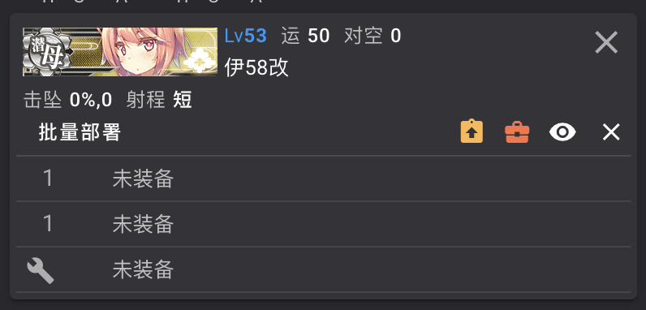
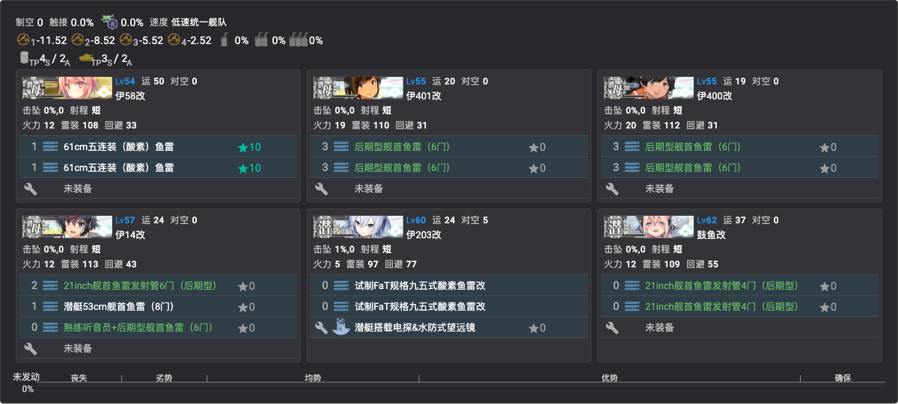
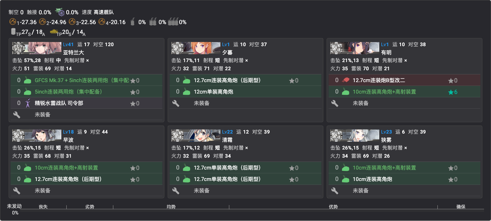
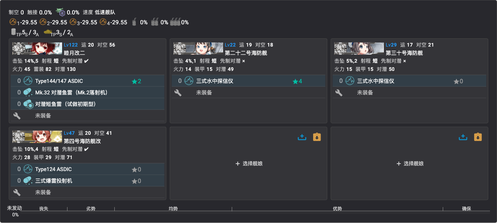

大家好，我是来自塔威塔威的輝夜花提督，尽管提督名不是这个（那个是旧名字）。

我着任塔威塔威已经6年多了，但是着任的前几年一方面没有经验，一方面没有社群支持，另外也没有渠道充值船位，玩的很艰苦，活动基本都是丙难度通关，没什么进展。我在2024年才开始认真游玩的（以取得力所能及的奖励为目标？）：

历次活动战绩

- 我在2024年早春活动取得了甲甲乙乙，那次真的很简单，但是我的练度很明显更低。
- 2024年夏季活动则是甲甲甲丁丁，能打到前三个甲感觉很了不起了，可惜没有船能打后段了，奖励也很贫瘠。
- 2025年春季活动取得了甲甲甲甲乙甲，E5的驱逐RA级真的是吓死我了，E6也是打到弹尽粮绝才艰难拿下。
- 2025年秋季活动取得了甲乙甲乙甲，因为我的时间比较紧迫，所以跳过了不太想要的奖励。
- 2026年夏季活动取得了甲甲甲甲甲，老实说太简单了，我甚至没看攻略网站，还自己写了攻略记录。

感觉这三年以来我也逐渐成为了（内心）强大的提督。

废话少说，今天给大家介绍一下我的日常出击任务攻略顺序吧。

## 日常出击任务

- **Bd1** 是出击胜利1次，我喜欢5-2C点单SS出击
- **Bd2** 也是出击胜利1次，但貌似失败了也可以完成
- **Bd3** 是与敌舰队交战10次（不要求胜利），这个一般会和Bd7一起做
- **Bd4** 是击沉敌方3条CV或者CVL（日期尾数为3/7/0时出现），和Bd7一起做
- **Bd5** 是击沉敌方3条补给舰，我会选5-3P提升一下低级驱逐舰的等级，但是有计数上的良性bug：只要接取了Bd6，即使没有接取Bd5，击沉的补给舰也会计入Bd5的进度
- **Bd6** 是击沉敌方5条补给舰（日期尾数为2或8时出现），和Bd5一起做
- **Bd7** 是在2图任意海域取得5次boss战胜利，我会选2-1，用6SS/V出击，顺便可以捞喷火
- **Bd8** 是击沉敌方6条SS，我会选1-5，顺带给DE刷闪

我听说很多人不喜欢做Bd7，说实话这个任务确实前期不好做，后期没必要做，但是吹雪改三护让喷火再次伟大了（笑）

我的日常也就是从这些零碎的日常任务开始的，就像现实稳定锚一样（不是稳定猫，那种事情不要啊）

## 参考编成

下面有一些参考编成，也许会有参考价值吧

### Bd1 / Bd2：5-2C 单SS

### Bd3 / Bd4 / Bd7：2-1 六潜艇

### Bd5 / Bd6：5-3P

### Bd8：1-5

