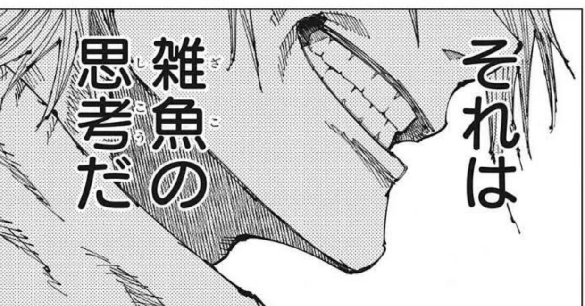
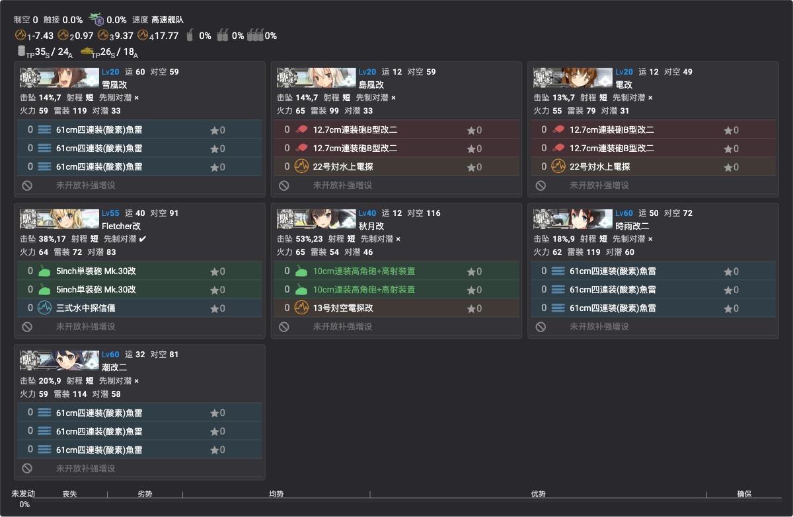
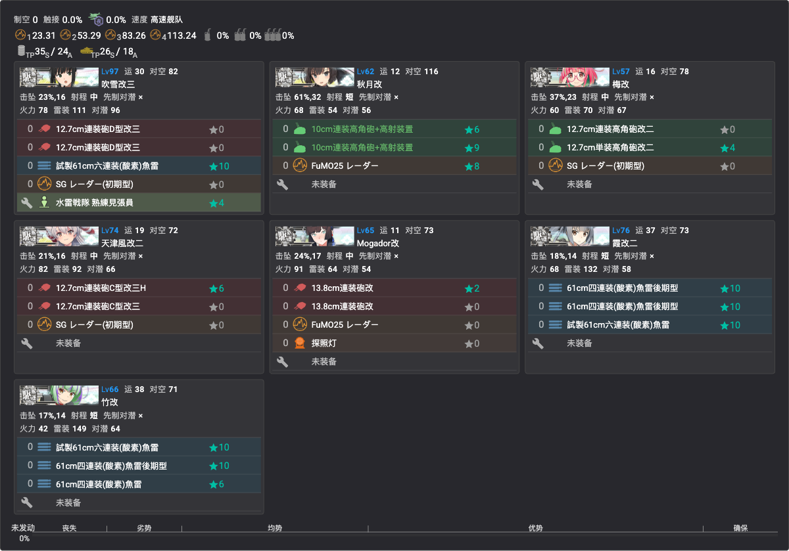
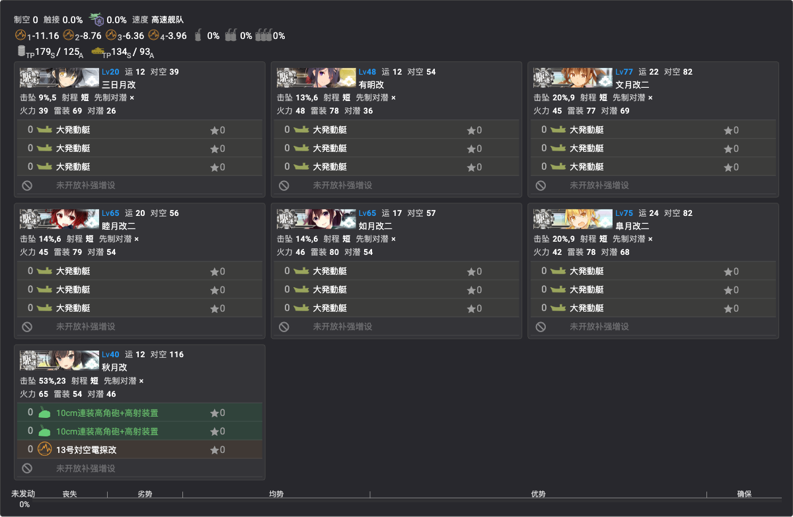
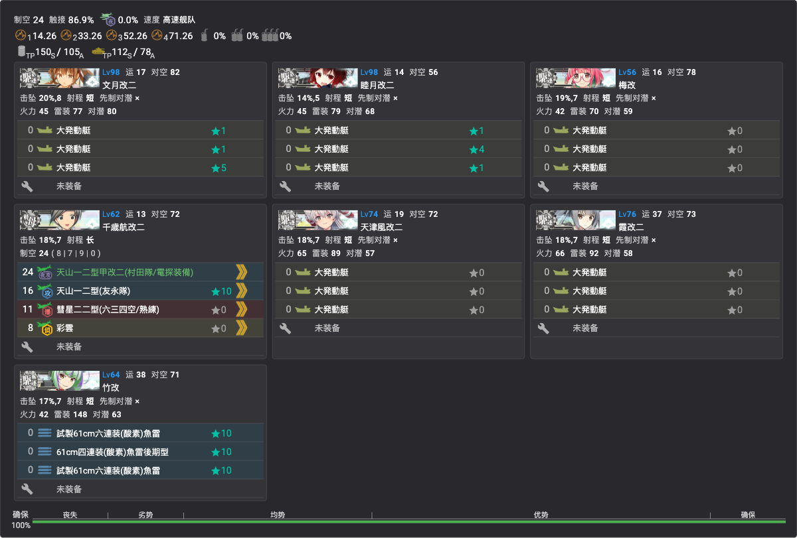
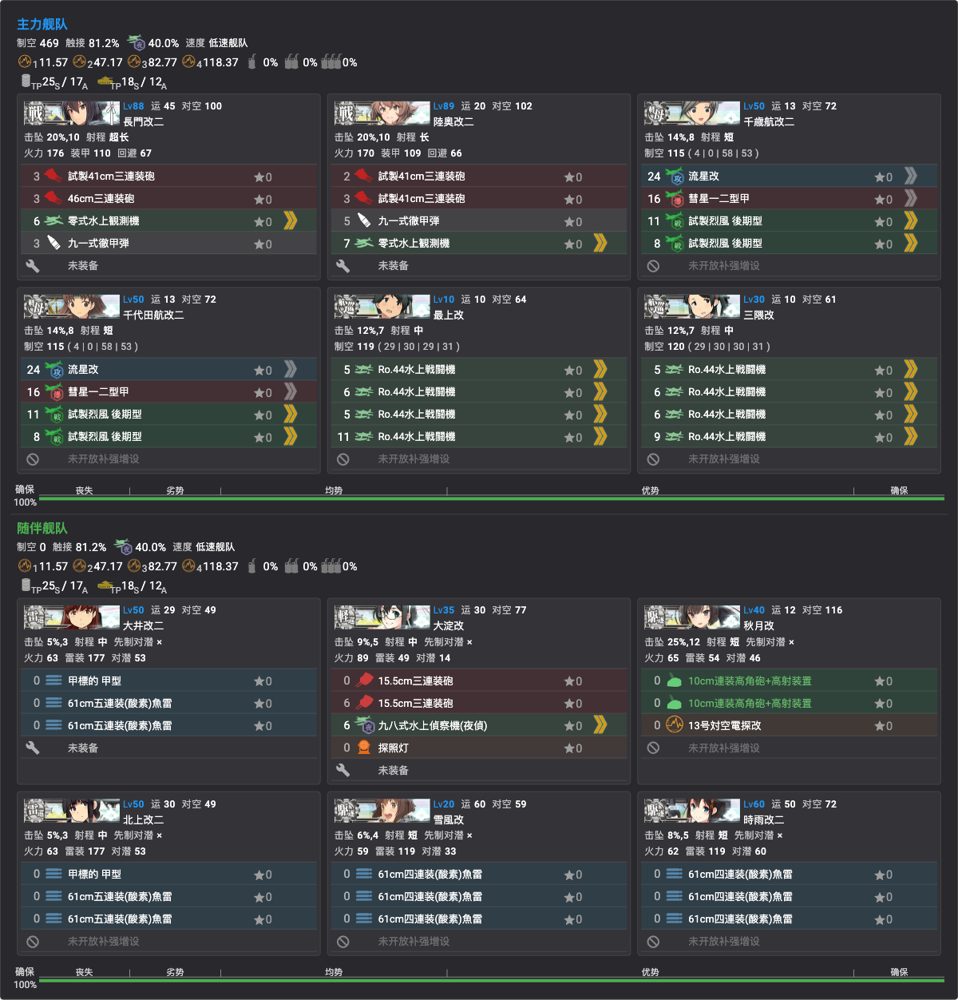
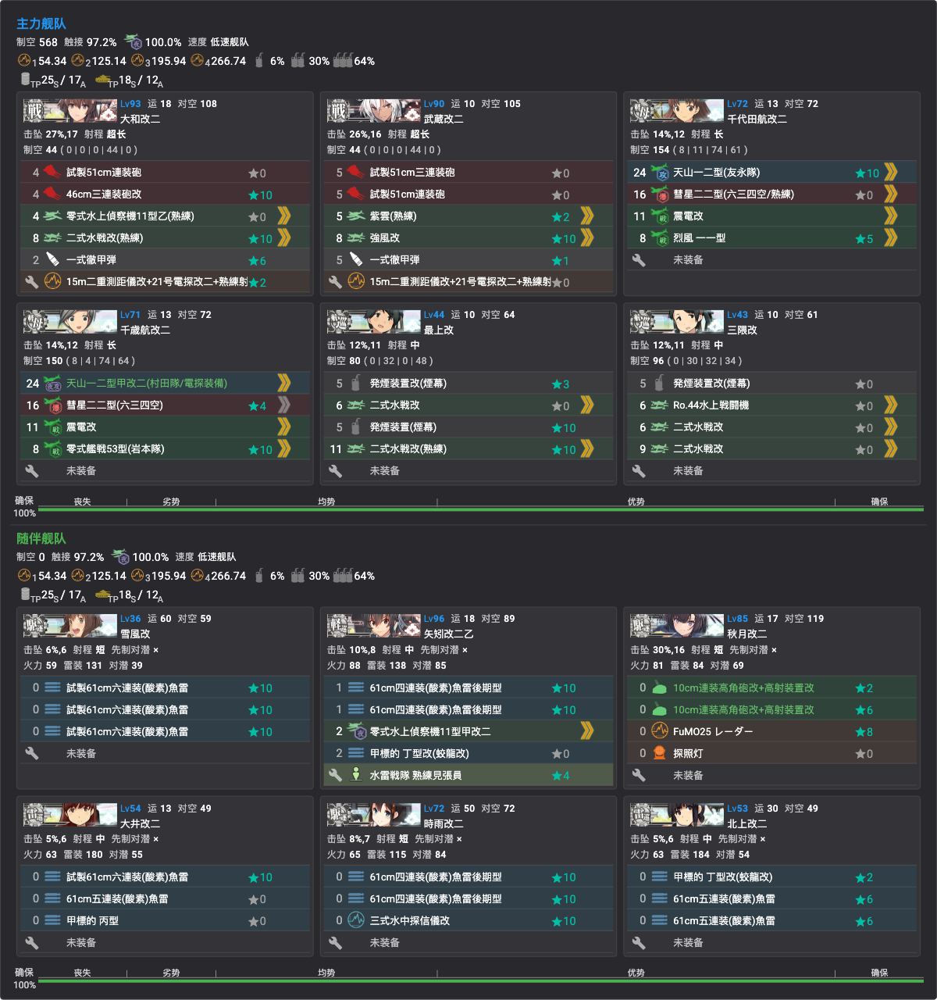
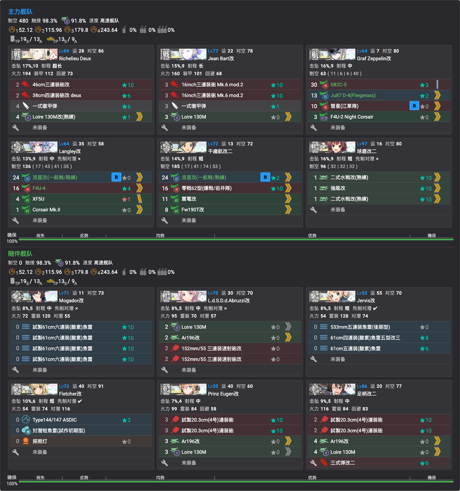
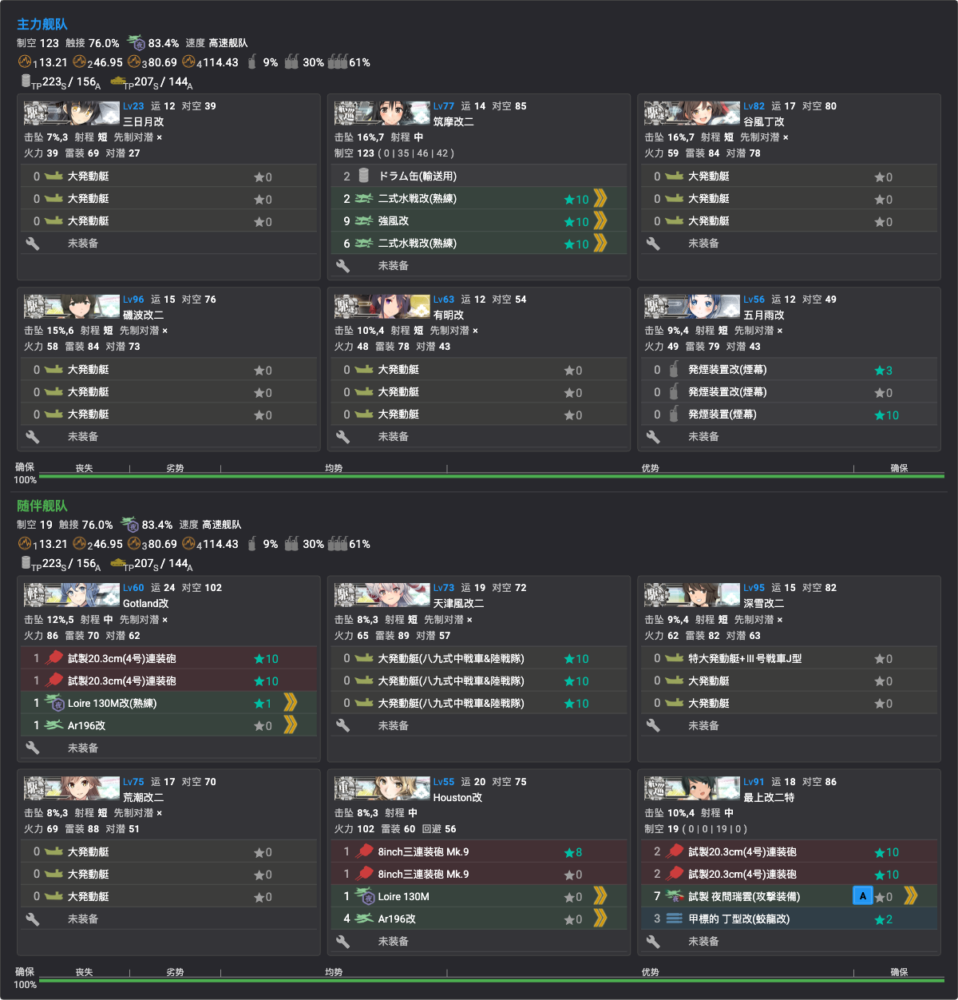
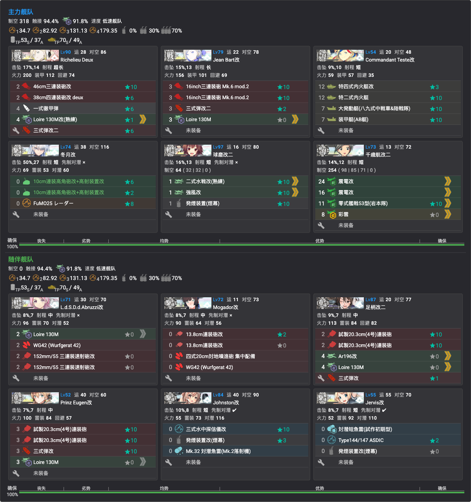

你好，我是塔威塔威的輝夜花，最近致力于收集图鉴。我想在这里分享一下自己在期间限定海域（以下称“活动”）开荒的思路，希望对没有甲种勋章的人有一些启发。

一直以来，我认识的其他提督攻略活动图时，基本都是等攻略网站产出作业再照抄（上学的时候经常会发生的事情）。毕竟一方面有资源的限制，另一方面还有舰娘贴条的限制，有时还有时间的限制，这使得“兴冲冲地跑进活动图里畅快地出击”的机会成本变得极大，最优解变成了“等后段海域开放”“等成熟攻略”“等友军舰队”“等友军舰队主力”，然后一板一眼地复制别人的舰队。

「但这是，废物的思维」

舰队收藏这款游戏最大的乐趣不就是“用体现自己智慧的编队，击破强大到无解的敌人”吗？全盘照抄别人的舰队，那就是把乐趣拱手相让了啊！

那么进入正题吧，我想讲的是“如何应对舰娘贴条（锁船）”。看似五花八门的编队实际上都是有固定模板的，我的想法就是先构建一队“最小可行舰队”，然后把其中的部件替换成更高级的，毕竟从0到1的突破才是最重要的。以下是一些构建的案例，实战编队都出自我的合集[《舰これ 2026夏活 全甲攻略合集》](/kancolle/2026summer/)：

## 游击舰队

假想敌人是单舰队的1姬+5DD，道中有空袭/潜水/水雷。

**假想编队**

7DD，一个对空（秋月），一个对潜（弗莱彻），剩下的位置配3个鱼雷CI（时雨/雪风/潮）的DD和2个二连的DD，优先选改造等级低的。CI舰放在旗舰位有发动率收益，放在队尾可以收尾boss；二连的DD因为运低，可以先擦伤boss。

**实战编队**

7DD，[2026夏E1-3](/kancolle/2026summer/e1/#p3攻坚-斩杀ラスダン)实战，思路和假想编队一样，只是换了等级更高、火力更高、倍卡更高的船和更强的装备。

## 游击运输

假想敌人是单舰队的1姬+5DD，道中有空袭/潜水/水雷。

**假想编队**

7DD，其中6个DD带满大发动艇，睦月级优先，1个DD对空（秋月），在boss点争取A胜运输。

**实战编队**

1CVL+6DD，[2026夏E1-2](/kancolle/2026summer/e1/#p2输送-tp)实战，路线分歧允许多带一个CVL抢制空/空袭/炮击，队尾带了一条鱼雷CI舰，争取在boss点S胜运输。

## 水上打击部队

假想敌人是2姬+2CV+2BB，伴随1CL+5DD。

**假想编队**

2BB+2CVL+2CAV，伴随1CL+2CLT+3DD，对应2026夏E2-2。长门/陆奥是最容易取得的特殊攻击BB，千岁/千代田是最便宜的高速CVL，最上/三隈是改造等级最低、搭载最大的CAV，北上/大井是最便宜的夜战战力，秋月对空，时雨/雪风打鱼雷CI，都是性价比之神。

**实战编队**

[2026夏E2-2](/kancolle/2026summer/e2/#p2攻坚)实战，和假想几乎一样，只是长门/陆奥换成了大和/武藏。

## 空母机动部队

水上打击部队的翻版，最上姐妹换成飞龙姐妹。下面是[2026夏E4-3](/kancolle/2026summer/e4/#p3攻坚boss-s-点)，实战里用的是别的船：战舰是 Richelieu／Jean Bart，空母是 Graf Zeppelin、Langley 和千岁，没有带飞龙姐妹。

**实战编队**

## 运输护卫部队

把两个单舰队运输粘在一起，下面是[2026夏E4-2](/kancolle/2026summer/e4/#p2输送boss-n-点)。

**实战编队**

## 对陆

一般舰队换上对陆装备，DD要优先考虑能携带登陆艇的，下面是[2026夏E4-4](/kancolle/2026summer/e4/#p4攻坚boss-x-点)。

**实战编队**

## 推荐复制的船

以下是我推荐练复制人（多号机）的船，等级是改造到对应形态所需的等级。

| 舰娘 | 舰种 | 改造等级 | 用途 |
| --- | --- | --- | --- |
| 雪风改 | DD | 20 | 鱼雷CI |
| 岛风改 | DD | 20 | 二连 |
| 三日月改 | DD | 20 | 大发运输 |
| 秋月改 | DD | 40 | 对空 |
| 有明改 | DD | 48 | 大发运输 |
| 夕暮改 | DD | 49 | 大发运输 |
| Fletcher改 | DD | 55 | 对潜 |
| 时雨改二 | DD | 60 | 鱼雷CI |
| 潮改二 | DD | 60 | 鱼雷CI |
| 霞改二 | DD | 75 | 大发&鱼雷CI |
| 大井改二 | CLT | 50 | 夜战战力 |
| 北上改二 | CLT | 50 | 夜战战力 |
| 最上改 | CAV | 10 | 水战制空 |
| 三隈改 | CAV | 30 | 水战制空 |
| 千岁航改二 | CVL | 50 | 高速轻空母 |
| 千代田航改二 | CVL | 50 | 高速轻空母 |
| 飞龙改二 | CV | 77 | 低成本空母 |
| 苍龙改二 | CV | 78 | 低成本空母 |
| 长门改二 | BB | 88 | 特殊攻击（需图纸） |
| 陆奥改二 | BB | 89 | 特殊攻击（需图纸） |

最后，祝各位提督全甲全船！